# Resumen Multinivel — Unidad 3: Administración de Procesos (Partes 3, 4, 5 y 6)

> **Ficha Panorámica:** Síntesis completa y detallada de la **Unidad 3 (Partes 3, 4, 5 y 6)** para el **2.º Parcial Teórico de Sistemas Operativos** (UTN FRC), elaborada a partir de las presentaciones oficiales de cátedra (Ing. Cecilia B. Sánchez) y completando todos los diagramas, códigos y explicaciones faltantes en `resumen teorico lichi.pdf`. *(Alcance del 2.º Parcial Teórico: Partes 3 a 6 de U3 + U4 Seguridad; no entran Parte 2, Memoria ni Docker).*

---

## Nivel 1: Visión General y Síntesis Ejecutiva

- **Tema central:** Cómo los Sistemas Operativos modernos paralelizan, sincronizan, comunican y planifican la ejecución de procesos e hilos sobre uno o múltiples procesadores.
- **Tesis organizadora:** Partiendo de la separación entre *asignación de recursos* y *unidad de ejecución* mediante **hilos** (Parte 3), el S.O. escala sobre arquitecturas **SMP, clusters y micronúcleos** (Parte 4), resuelve los conflictos de concurrencia mediante **exclusión mutua y paso de mensajes** (Parte 5) y optimiza el reparto de CPU mediante **planificadores y algoritmos** (Parte 6).
- **Mapa de partes evaluadas:**
  1. **Parte 3:** Hilos (*threads*), entornos monohilo/multihilo, estados, RPC e implementación **ULT vs. KLT**.
  2. **Parte 4:** Procesamiento paralelo (Maestro/Esclavo, SMP), Agrupaciones (*Clusters*) y Arquitectura Micronúcleo.
  3. **Parte 5:** Concurrencia, condiciones de competencia, sección crítica, exclusión mutua (con y sin espera ocupada), Productor-Consumidor, Semáforos, Monitores y Mensajes.
  4. **Parte 6:** Planificadores (largo, mediano y corto plazo), criterios, apropiativo vs. no apropiativo y algoritmos (FCFS, SJF, SRTN, Round Robin, Prioridad, Colas Múltiples, Garantizada).

---

## Nivel 2: Desarrollo Analítico Completo por Partes

---

## Parte 3 — Hilos (*Threads*)

### 3.1 Concepto de Hilo vs. Proceso y Entornos

Un proceso tradicional concentra **dos características independientes** que los sistemas modernos separan:
1. **Propiedad de recursos:** espacio de direcciones virtuales, archivos abiertos, dispositivos (**Imagen del proceso**).
2. **Planificación / ejecución:** unidad que se despacha en la CPU (**Traza del proceso**).

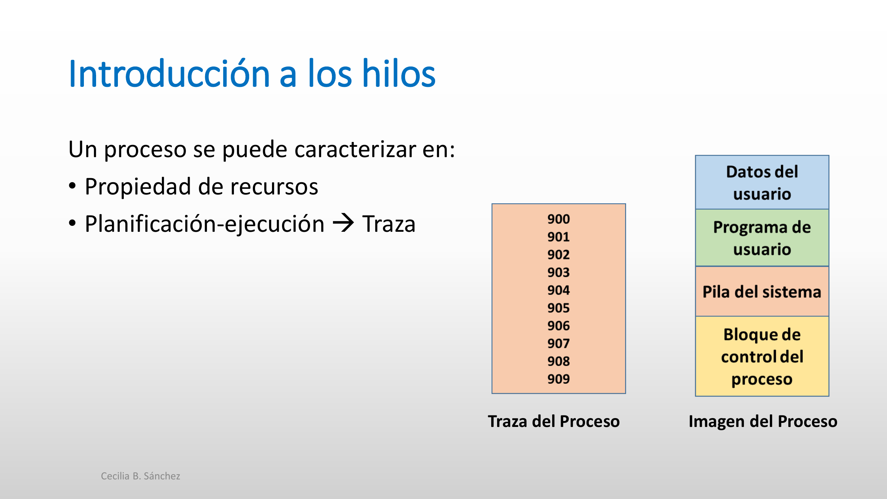

- **Hilo (*thread*, subproceso o proceso ligero):** contexto de ejecución que **se planifica de forma independiente**, pero que **comparte un mismo espacio de direcciones y recursos con otros hilos** del mismo proceso.
- **Proceso (en entorno multihilo):** conjunto de uno o más hilos y los recursos del sistema asociados. Se define como la **unidad de asignación de recursos** (el hilo es la **unidad de ejecución/planificación**).

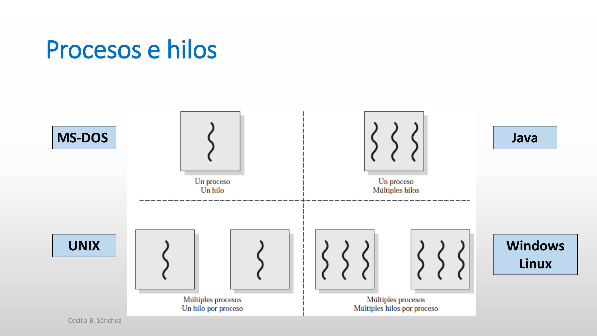

| Clasificación | Ejemplos de S.O. / Entorno |
|---|---|
| Un proceso, un hilo | **MS-DOS** |
| Múltiples procesos, un hilo por proceso | **UNIX tradicional** |
| Un proceso, múltiples hilos | **Entorno de ejecución Java (JVM)** |
| Múltiples procesos, múltiples hilos por proceso | **Windows, Linux** |

### 3.2 Entorno Monohilo vs. Entorno Multihilo

| Entorno Monohilo | Entorno Multihilo |
|---|---|
| 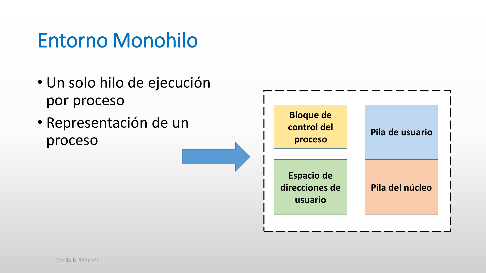 | 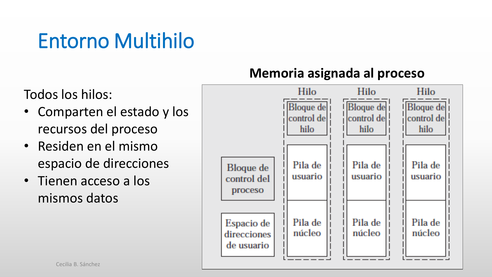 |
| Un único hilo por proceso: 1 PCB, 1 espacio de direcciones, 1 pila de usuario y 1 pila del núcleo. | 1 PCB y 1 espacio de direcciones compartidos; **cada hilo** tiene su propio **bloque de control de hilo**, **pila de usuario** y **pila de núcleo**. |

**Desglose estricto (muy evaluado en parcial — Preguntas 3 y 5 de `parcial p2 sop napter.pdf`):**
- **Elementos del Proceso (compartidos por todos los hilos DEL MISMO proceso):**
  - Espacio de direcciones virtuales que contiene la imagen del proceso.
  - Acceso protegido a procesadores, otros procesos, archivos y recursos de E/S.
  - Estado global y recursos del proceso, y acceso a los mismos datos globales del proceso.
  - *(Trampa clásica: los hilos comparten memoria y recursos con los hilos de **su mismo proceso**, ¡NUNCA con hilos de todos los procesos!)*
- **Elementos propios de CADA Hilo:**
  - **Estado del hilo** (*Ejecución*, *Listo*, *Bloqueado*).
  - **Contexto del procesador:** contador de programa (PC) y registros independientes.
  - **Pila de ejecución** (pila de usuario y pila de núcleo).
  - **Almacenamiento estático para variables locales**.

### 3.3 Ventajas, Estados y Ejemplo RPC de los Hilos

- **6 Ventajas de los hilos frente a procesos independientes:**
  1. Facilita el diseño de aplicaciones que realizan distintas funciones simultáneamente.
  2. La **creación** de un nuevo hilo es mucho más rápida que la de un proceso.
  3. La **terminación** de un hilo es más rápida que la de un proceso.
  4. Mayor **rapidez para cambiar** de un hilo a otro dentro del mismo proceso.
  5. Los hilos de un mismo proceso **se comunican directamente sin acceder al núcleo** (comparten memoria).
  6. Es más eficiente relacionar un conjunto de hilos que un conjunto de procesos.

- **Estados principales de un hilo:** **Listo**, **Ejecución** y **Bloqueado**.
  *(Trampa de parcial — Pregunta 6: **Terminado/Finalizado NO es un estado principal** de un hilo).*
  - *¿Qué pasa con los hilos si se **suspende** el proceso?* → Como comparten el espacio de direcciones del proceso, si el proceso es llevado a disco (suspendido), **todos sus hilos se suspenden**.
  - *¿Qué pasa con los hilos si **finaliza** el proceso?* → **Finalizan todos sus hilos** porque pierden su espacio de direcciones y recursos.

- **Caso práctico: Peticiones RPC (*Remote Procedure Call*) con 1 hilo vs. 2 hilos:**

| Proceso con 1 único hilo | Proceso con 2 hilos |
|---|---|
| 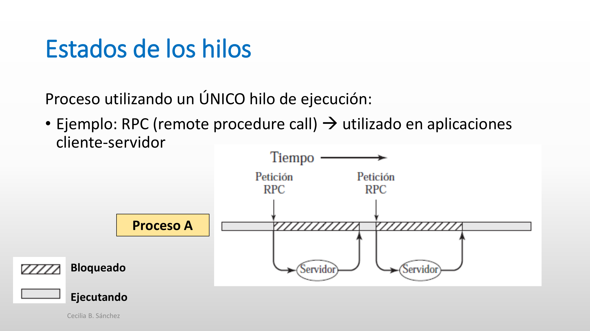 | 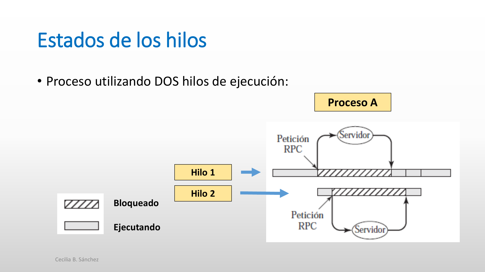 |
| Al hacer una petición RPC al servidor, todo el proceso queda **bloqueado** esperando la respuesta sin poder avanzar. | Cuando el Hilo 1 se bloquea esperando la RPC, el **Hilo 2 puede ejecutarse** y enviar otra petición en paralelo. |

### 3.4 Implementación de Hilos: ULT vs. KLT

| Criterio | **ULT (*User Level Threads*)** — Hilos a nivel de usuario | **KLT (*Kernel Level Threads*)** — Hilos a nivel de kernel |
|---|---|---|
| Diagrama | 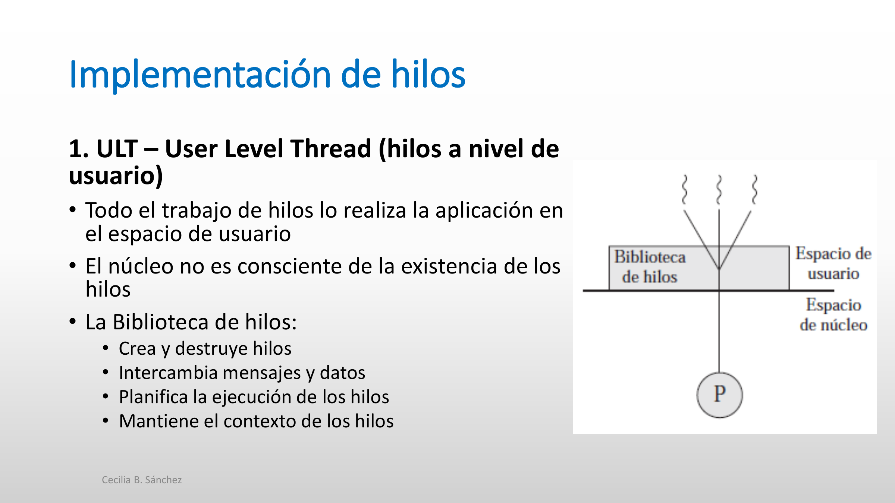 | 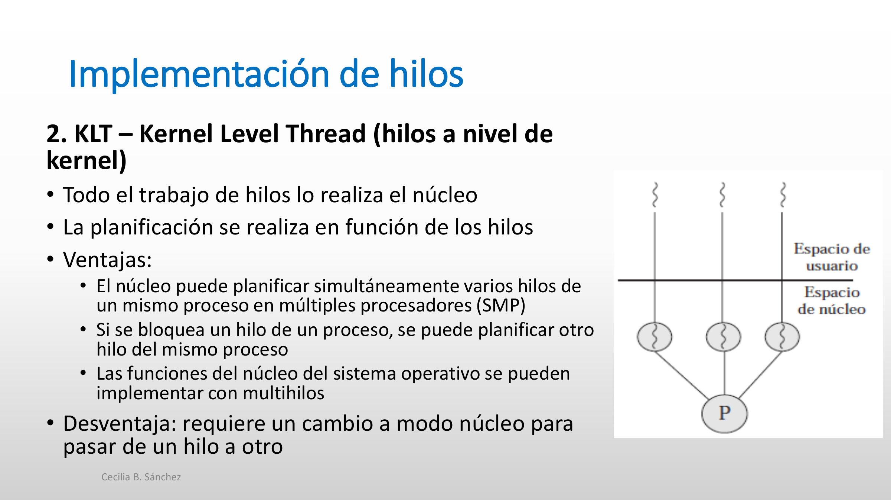 |
| **Quién gestiona** | La aplicación mediante una **biblioteca de hilos en espacio de usuario** (crea, destruye, intercambia mensajes, planifica y mantiene contextos). El kernel **no conoce** los hilos (solo ve 1 proceso `P`). | **Todo el trabajo lo realiza el núcleo** (kernel). La planificación de CPU se realiza en función de los hilos. |
| **Ventajas** | - Cambio de hilo **sin cambiar a modo núcleo** (muy rápido).<br>- Planificación adaptable por la biblioteca de hilos.<br>- Se ejecutan en **cualquier S.O.** sin requerir soporte del kernel. | - El núcleo puede planificar **simultáneamente** varios hilos del mismo proceso en **múltiples procesadores (SMP)**.<br>- Si se bloquea un hilo, el kernel puede planificar **otro hilo del mismo proceso**.<br>- Las funciones del propio núcleo pueden implementarse con multihilos. |
| **Desventajas** | - Si un hilo realiza una llamada bloqueante al S.O., **se bloquean todos los hilos del proceso**.<br>- **No aprovecha el multiprocesamiento** (el kernel solo asigna 1 CPU al proceso). | - **Requiere un cambio a modo núcleo** para pasar de un hilo a otro (mayor sobrecarga que ULT). |

---

## Parte 4 — SMP, Clusters y Micronúcleos

### 4.1 Clasificación del Procesamiento Paralelo

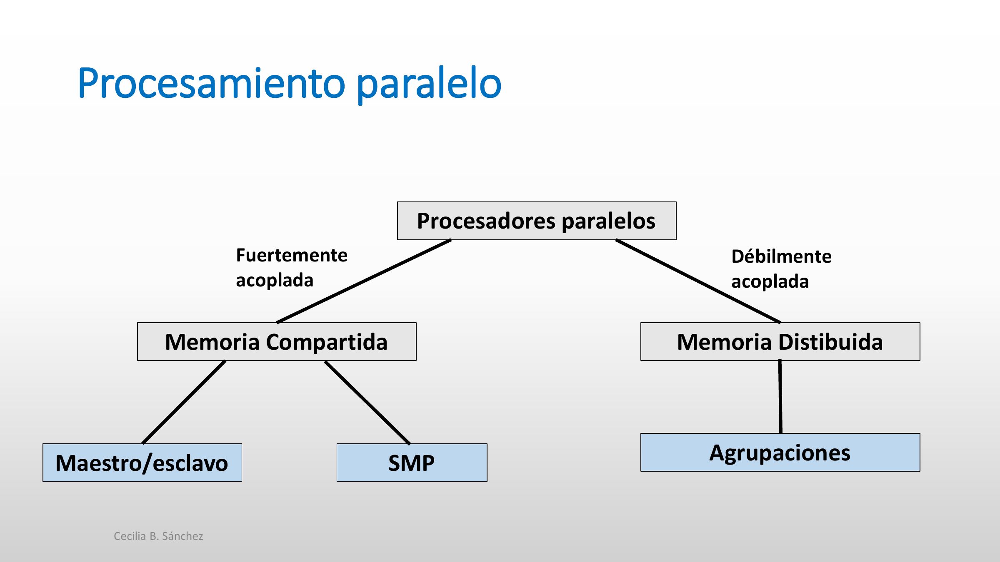

- **Fuertemente acoplada (Memoria Compartida):** todos los procesadores comparten memoria principal → **Maestro/Esclavo** y **SMP**.
- **Débilmente acoplada (Memoria Distribuida):** cada computadora/nodo posee su propia memoria y discos, comunicados por red → **Agrupaciones (*Clusters*)**.

### 4.2 Arquitectura Maestro/Esclavo vs. SMP

| Característica | **Arquitectura Maestro/Esclavo** | **SMP (*Symmetric MultiProcessing*)** |
|---|---|---|
| Diagrama | 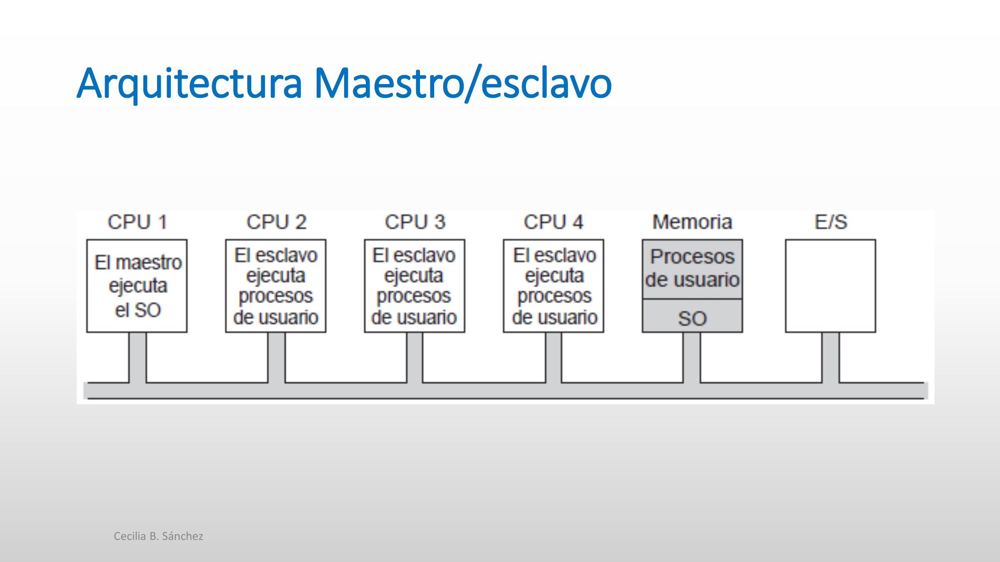 | 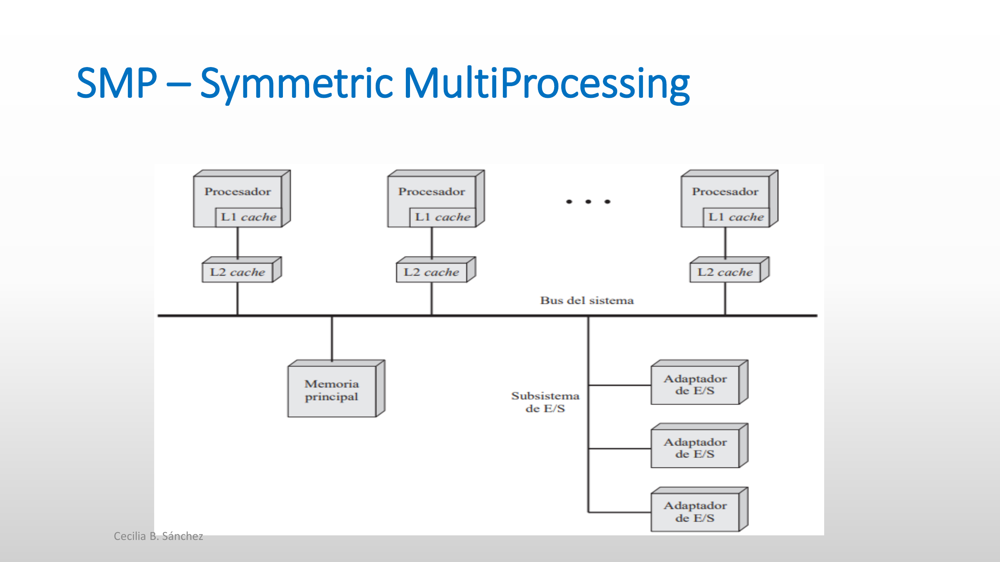 |
| **Dónde corre el S.O.** | El núcleo del S.O. se ejecuta **siempre en el mismo procesador** (el maestro). Los esclavos solo ejecutan programas de usuario. | El núcleo del S.O. **se puede ejecutar en cualquier procesador**. Todos los procesadores son **simétricos** (pueden desempeñar las mismas funciones). |
| **Recursos y control** | Un único procesador (maestro) controla la memoria y la E/S. | Dos o más procesadores comparten memoria principal y dispositivos de E/S. Cada procesador se **auto-planifica** bajo un S.O. integrado. |
| **Ventajas** | Simplicidad de diseño (no hay concurrencia del kernel entre CPUs). | - Ejecución real en paralelo de procesos/hilos.<br>- **Alta disponibilidad:** si falla un procesador, el sistema sigue funcionando.<br>- **Crecimiento incremental:** se agregan CPUs para escalar rendimiento. |
| **Desventajas / Desafíos** | - **Punto único de fallo:** si cae el maestro, cae todo el sistema.<br>- **Cuello de botella:** el maestro satura al atender todas las peticiones del S.O. | - **Conflictos de planificación:** evitar que dos CPUs seleccionen el mismo proceso/hilo.<br>- **Coherencia de caché** (L1/L2 privadas frente a RAM compartida).<br>- **Sincronización** de zonas de memoria compartidas. |

### 4.3 Agrupaciones (*Clusters*)

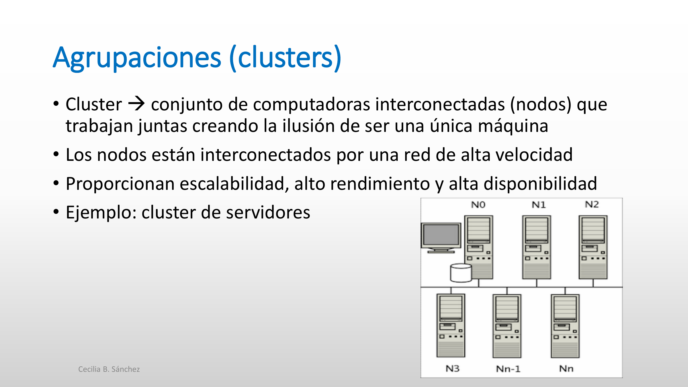

- **Definición:** conjunto de computadoras completas interconectadas (**nodos**) que trabajan juntas **creando la ilusión de ser una única máquina** (ej.: *cluster* de servidores).
- **Cómo se conectan:** mediante una **red de alta velocidad** (no comparten obligatoriamente la misma memoria principal física; usan memoria distribuida).
- **Beneficios principales (evaluados en Pregunta 7 del parcial):** proporcionan **escalabilidad**, **alto rendimiento** y **alta disponibilidad**.

### 4.4 Evolución de la Arquitectura de S.O. y Arquitectura Micronúcleo

La arquitectura de los Sistemas Operativos evolucionó por tres modelos: **1. Sistemas Monolíticos** → **2. Sistemas por Capas/Niveles** → **3. Arquitectura Micronúcleo**.

| Sistemas por Capas | Arquitectura Micronúcleo |
|---|---|
| 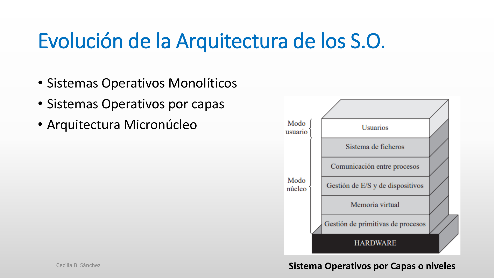 | 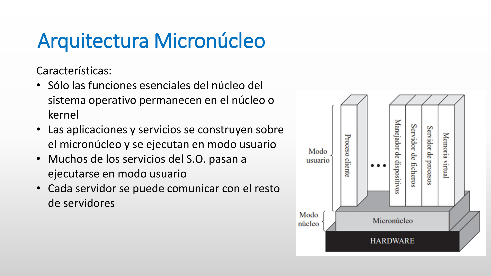 |

- **Características de la Arquitectura Micronúcleo:**
  - **Solo las funciones esenciales** permanecen en el núcleo (modo núcleo / *kernel*).
  - **Muchos de los servicios del S.O.** (sistema de ficheros, manejadores de dispositivos, memoria virtual de alto nivel, servidor de procesos) se implementan como **procesos servidores** que corren en **modo usuario**.
  - Adopta una **arquitectura cliente-servidor**: los clientes envían *peticiones* y los servidores devuelven *respuestas*.
  - La comunicación se realiza mediante **paso de mensajes**; el micronúcleo permite, administra y protege dicho intercambio entre servidores y clientes.

- **3 Funciones que permanecen dentro del Micronúcleo:**
  1. **Gestión de memoria a bajo nivel:** traducción de dirección de página virtual a marco físico.
  2. **Comunicación entre procesos (IPC):** mediante paso de mensajes (asociando **puertos** a cada proceso).
  3. **Gestión de interrupciones y Entrada/Salida** (nivel más bajo).

- **7 Ventajas del Micronúcleo:**
  1. **Uniformidad de interfaces** (todo se comunica mediante mensajes).
  2. **Extensibilidad** (fácil añadir nuevos servicios en modo usuario).
  3. **Flexibilidad** (adaptación a necesidades del usuario).
  4. **Portabilidad** (código dependiente del hardware reducido y aislado en el núcleo pequeño).
  5. **Fiabilidad** (al ser pequeño, puede probarse rigurosamente).
  6. **Soporte para sistemas distribuidos** (por su modelo cliente-servidor).
  7. **Soporte para S.O. orientados a objetos**.

---

## Parte 5 — Comunicación entre Procesos (IPC y Concurrencia)

### 5.1 Procesos Concurrentes, Multiprogramación y Multiprocesamiento

- **Procesamiento Secuencial:** un proceso termina completamente antes de que comience el siguiente.
- **Procesamiento Concurrente:** dos procesos son concurrentes si **su ejecución se superpone en el tiempo**, es decir, si la primera instrucción de uno comienza antes de que se complete la última instrucción del otro.
  - **Procesos disjuntos (no interactuantes):** operan sobre conjuntos de variables disjuntas (si comparten variables, es **solo para lectura**).
  - **Procesos interactuantes:** procesos dependientes del tiempo; la ejecución de uno depende del otro y comparten variables para **lectura y escritura** (o tuberías como `# ls -l | grep arch?? | wc -l`).

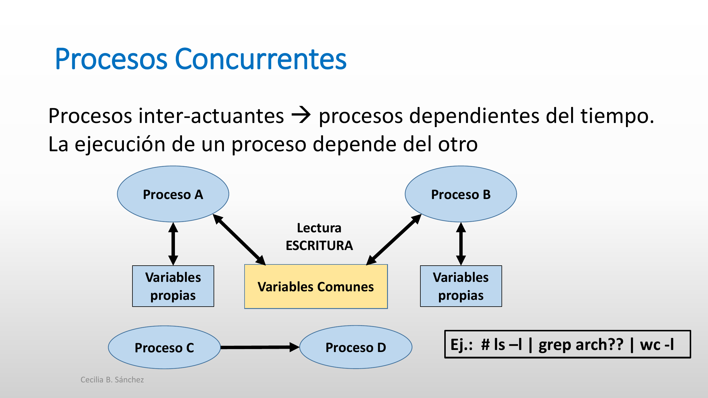

| **Multiprogramación** (1 CPU) | **Multiprocesamiento** (Múltiples CPUs) |
|---|---|
| 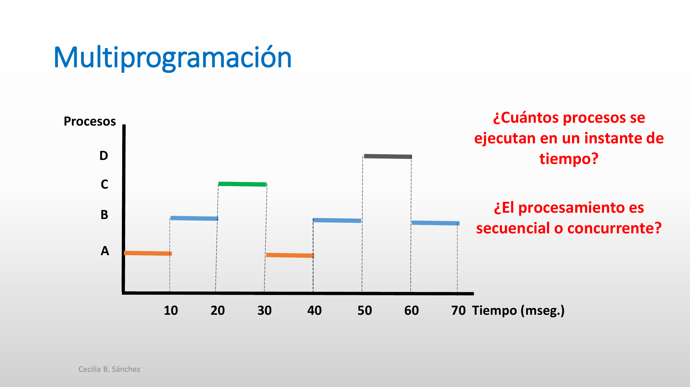 | 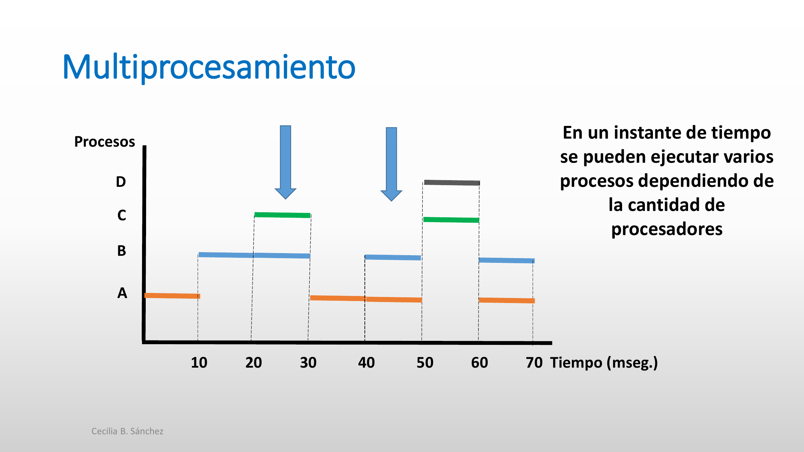 |
| En un instante dado se ejecuta **solo 1 proceso**, alternando rápidamente en la CPU → el procesamiento **es concurrente** (aunque no paralelo en el mismo instante). | En un mismo instante de tiempo pueden ejecutarse **varios procesos en paralelo** (dependiendo de la cantidad de procesadores). |

### 5.2 Condiciones de Competencia, Sección Crítica y Exclusión Mutua

- **Ejemplo de cátedra (Spooler de impresión):**
  - El Proceso A lee `IN = 7` (`Ranura_libre = 7`), pero antes de escribir su archivo en la ranura 7 y actualizar `IN`, el planificador lo interrumpe y ejecuta al Proceso B.
  - El Proceso B también lee `IN = 7`, escribe `ARCH_B` en la ranura 7 y actualiza `IN = 8`.
  - Cuando retoma el Proceso A, conserva su variable local `Ranura_libre = 7` y escribe `ARCH_A` encima de la ranura 7, **sobrescribiendo/perdiendo el archivo del Proceso B**.
- **Condición de competencia (*Race Condition*):** situación en la que dos o más procesos leen o escriben datos en lugares compartidos y el **resultado final depende de quién ejecuta qué y en qué momento** (orden de intercalación).
- **Sección Crítica:** parte del programa en la cual el proceso accede a la memoria o recurso compartido.

> **Rúbrica de Examen (Pregunta 12 real de UV): ¿Cómo evitar las condiciones de competencia?**
> Mediante el principio de **EXCLUSIÓN MUTUA** (prohibir que más de un proceso acceda simultáneamente a su sección crítica para leer/escribir datos compartidos), cumpliendo obligatoriamente estas **4 condiciones**:
> 1. **Exclusión mutua:** no puede haber dos procesos **dentro de sus secciones críticas al mismo tiempo**.
> 2. **Progreso:** ningún proceso que se ejecute **fuera** de su sección crítica puede bloquear a otro proceso.
> 3. **Espera limitada:** ningún proceso debe **esperar eternamente** para ingresar a su sección crítica (evita inanición).
> 4. **Independencia del hardware:** no se pueden hacer suposiciones acerca de la **velocidad relativa** de los procesos ni de la **cantidad de CPUs**.

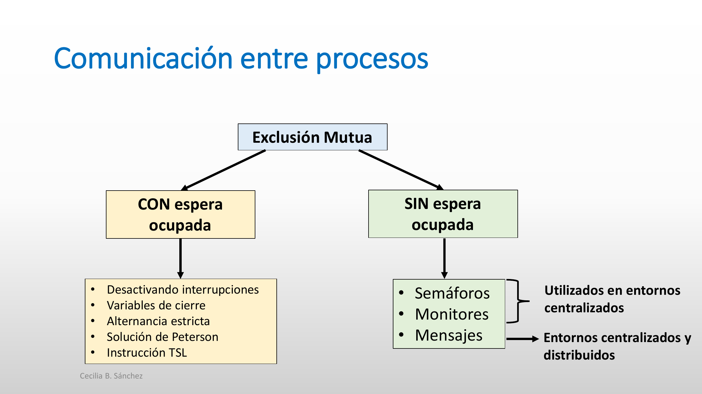

| Tipo de Exclusión Mutua | Mecanismos | Ámbito y característica |
|---|---|---|
| **CON espera ocupada** *(busy waiting)* | - Desactivación de interrupciones<br>- Variables de cierre (*lock*)<br>- Alternancia estricta<br>- Solución de Peterson<br>- Instrucción `TSL` (*Test and Set Lock*) | El proceso consume CPU consultando continuamente en un ciclo si puede entrar a la sección crítica. |
| **SIN espera ocupada** | - **Semáforos** (entornos centralizados)<br>- **Monitores** (entornos centralizados)<br>- **Mensajes** (entornos **centralizados y distribuidos**) | **Optimiza el uso de CPU:** si el recurso está ocupado, el proceso se bloquea usando primitivas **`SLEEP`** (bloquea/desactiva el proceso) y **`WAKEUP`** (despierta/activa un proceso bloqueado). |

### 5.3 Problema del Productor y Consumidor, Semáforos y Monitores

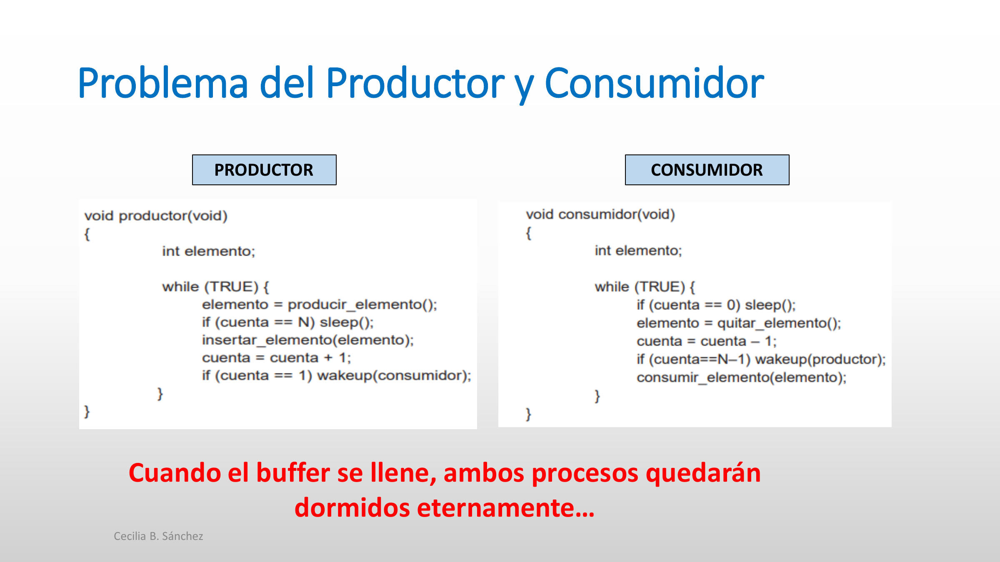

```c
#define N 100
int cuenta = 0;

void productor(void) {
    int elemento;
    while (TRUE) {
        elemento = producir_elemento();
        if (cuenta == N) sleep();
        insertar_elemento(elemento);
        cuenta = cuenta + 1;
        if (cuenta == 1) wakeup(consumidor);
    }
}

void consumidor(void) {
    int elemento;
    while (TRUE) {
        if (cuenta == 0) sleep();
        elemento = quitar_elemento();
        cuenta = cuenta - 1;
        if (cuenta == N - 1) wakeup(productor);
        consumir_elemento(elemento);
    }
}
```

- **¿Por qué falla la solución ingenua con `sleep` y `wakeup`?**
  1. El Consumidor lee `cuenta == 0`, pero **justo antes de ejecutar `sleep()`**, el planificador le da la CPU al Productor.
  2. El Productor inserta un elemento, hace `cuenta = 1`, ve `cuenta == 1` y envía `wakeup(consumidor)`. Como el Consumidor aún no estaba dormido, **la señal `wakeup` se pierde**.
  3. El Productor sigue llenando el *buffer* hasta `cuenta == N` y ejecuta `sleep()`.
  4. Al volver el Consumidor, reanuda justo en `sleep()` y también se duerme. **Resultado: ambos procesos quedan dormidos eternamente.**

- **Semáforos:**
  - Variables enteras protegidas con operaciones atómicas **`DOWN`** (verifica si `S > 0`; si es positivo decrementa y continúa, si es `0` duerme al proceso) y **`UP`** (incrementa el semáforo y despierta si había alguno esperando). Acumulan los `wakeup` pendientes evitando su pérdida.
  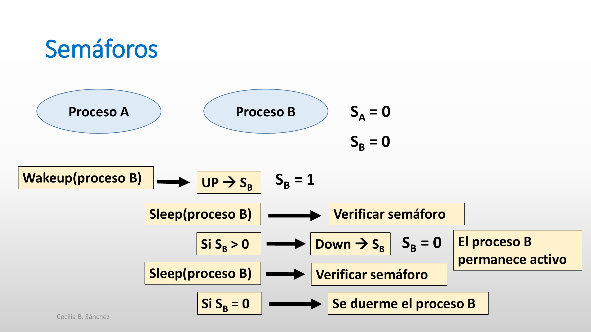

- **Monitores:**
  - Primitiva de sincronización de **alto nivel**: conjunto de procedimientos, variables y estructuras de datos agrupados en un módulo o paquete.
  - **Regla de oro:** solo puede haber **un único proceso activo** dentro de un monitor en un instante dado (el compilador garantiza la exclusión mutua automáticamente).
  - *Ejemplo de cátedra:* palabra reservada `synchronized` en Java.

### 5.4 Paso de Mensajes

Método de comunicación entre procesos utilizado tanto en **entornos centralizados como distribuidos** (intercambio de información entre un proceso emisor y un receptor).

- **Formato del mensaje:** se divide en **Cabecera** (`ORIGEN`, `DESTINO`, `Nro. de Secuencia`, **`C.R.C.`**, `LONGITUD`) y **Datos**.
  - **`C.R.C.` (*Código de Redundancia Cíclica*):** controla la **integridad** del mensaje (detecta errores de transmisión).
  - **Fragmentación:** si se desea enviar un archivo muy grande, se divide en múltiples paquetes numerados con `Nro. Sec = 1, 2, 3...`.

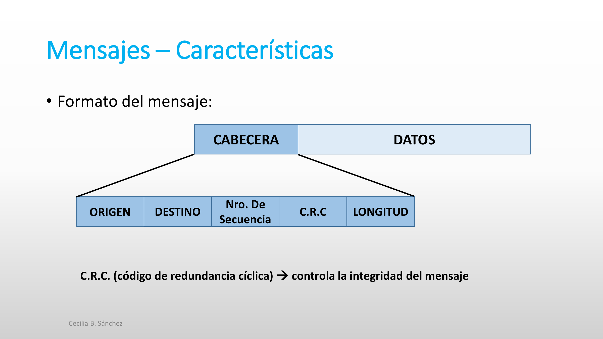

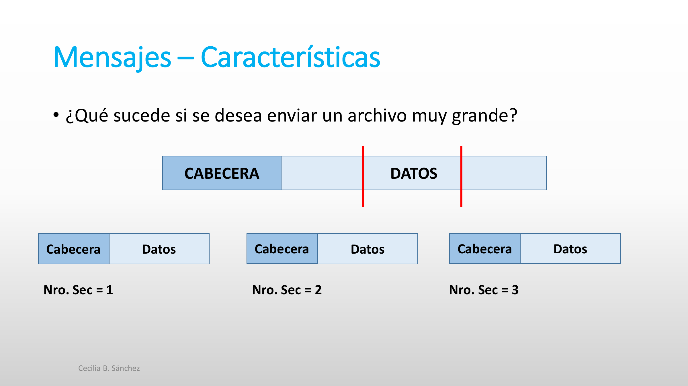

- **Tipos de comunicación y longitud:**
  - **Sincrónica:** emisor y receptor deben acordar previamente el intercambio (bloqueante hasta la entrega/recepción).
  - **Asincrónica:** utiliza un ***buffer* (almacenamiento intermedio)** entre emisor y receptor (mayor velocidad al no esperar).
  - **Longitud:** **Fija** (cabecera y/o datos de tamaño constante) o **Variable**.

- **Transferencia de mensajes (4 aspectos):**
  1. **Primitivas de comunicación/sincronización:** `Send(destino, mensaje)` y `Receive(origen, mensaje)`.
  2. **Reconocimiento (*Acknowledgement* / `ACK`):** en máquinas distintas, el receptor envía un `ACK` al emisor confirmando la recepción correcta para garantizar que no se pierda ningún mensaje.
     - *Caso pérdida de mensaje 2:* A no recibe `ACK-2` y retransmite el mensaje 2.
     - *Caso pérdida de `ACK-2`:* B ya recibió el mensaje 2, pero A no recibió el `ACK-2` y vuelve a retransmitir el mensaje 2. B usa el **`Nro. de Secuencia`** de la cabecera para detectar que el mensaje es **duplicado** (descarta la copia y reenvía `ACK-2`).
     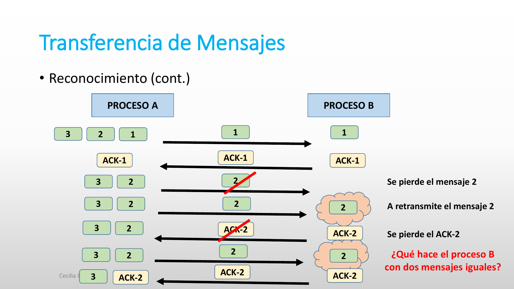
  3. **Autenticación:** autenticar al emisor antes de procesar sus mensajes.
  4. **Rendimiento:** cantidad de información enviada por unidad de tiempo, medida en **`bps`** (*bits per second*: $\text{Kbps}=10^3$, $\text{Mbps}=10^6$, $\text{Gbps}=10^9\text{ bps}$).

---

## Parte 6 — Planificación de Procesos

### 6.1 Planificadores según su Frecuencia de Ejecución

Un **planificador** es la parte del S.O. que decide **cuál proceso ejecutar y durante cuánto tiempo**.

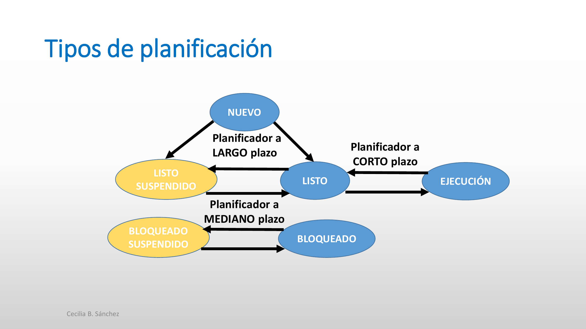

| Planificador | Frecuencia | Función principal y transiciones que gobierna |
|---|---|---|
| **Largo plazo** | **Menor** frecuencia | Decide **cuándo se acepta un nuevo proceso** en el sistema (*Nuevo → Listo* o *Nuevo → Listo Suspendido*). Controla el **grado de multiprogramación**. |
| **Mediano plazo** | Intermedia | Relacionado con la función de intercambio (**swapping**). Decide en qué momento suspender (llevar a disco) y activar procesos (*Listo ↔ Listo Suspendido* y *Bloqueado ↔ Bloqueado Suspendido*). |
| **Corto plazo** | **Mayor** frecuencia | Selecciona qué proceso pasa de **Listo → Ejecución**. Se ejecuta ante: **1) Interrupciones de reloj**, **2) Interrupciones de E/S** y **3) Llamadas al sistema**. |

### 6.2 Criterios y Tipos de Algoritmos de Planificación

- **7 Criterios de planificación:**
  1. **Equidad** (dar un trato justo a los procesos).
  2. **Equilibrio** (mantener ocupadas todas las partes del sistema).
  3. **Utilización del procesador** (mantener la CPU ocupada).
  4. **Minimizar el tiempo de respuesta** → criterio orientado a **procesos interactivos** *(Pregunta 15 del parcial)*.
  5. **Minimizar el tiempo de retorno** → criterio orientado a **procesos por lotes**.
  6. **Previsibilidad** (independencia respecto a la carga del sistema).
  7. **Maximizar el rendimiento** (*throughput*: procesos completados por unidad de tiempo).

- **Apropiativo vs. No Apropiativo:**
  - **No apropiativo (sin expulsión):** una vez que un proceso recibe la CPU, la retiene hasta que **finaliza** o **se bloquea** (p. ej. por E/S).
  - **Apropiativo (con expulsión):** el proceso ejecuta durante un tiempo máximo (**quantum**), controlado mediante **interrupciones de reloj**, pudiendo ser expulsado y devuelto a *Listo*.

### 6.3 Algoritmos de Planificación (Lotes vs. Interactivos)

#### A) Planificación en sistemas de procesamiento por lotes
1. **FCFS (*First Come, First Served*) / FIFO:**
   - **No apropiativo** y sencillo de programar. Los procesos pasan en orden de llegada a ejecución. Si el proceso en ejecución pide E/S, pasa a *Bloqueado* y, al obtener los datos, vuelve **al final de la cola de Listos**.
2. **SJF (*Shortest Job First* — Primero el trabajo más corto):**
   - Selecciona el trabajo de menor duración estimada (requiere **conocer de antemano** el tiempo de cada proceso).
   - *Ejemplo de cátedra:* para procesos de `8, 4, 2, 1` min, en orden original el tiempo promedio de espera/terminación es $(8+12+14+15)/4 = 49/4 = \mathbf{12{,}25\text{ min}}$; ordenando del más corto al más largo (`1, 2, 4, 8`) baja a $(1+3+7+15)/4 = 26/4 = \mathbf{6{,}5\text{ min}}$. Fórmula general para 4 procesos: $(4a' + 3b' + 2c' + d') / 4$.
3. **SRTN (*Shortest Remaining Time Next* — Menor tiempo restante):**
   - Versión **apropiativa** de SJF: selecciona siempre el proceso cuyo tiempo **restante** de ejecución sea el más corto. Si llega un proceso nuevo más corto que lo que le resta al actual, lo expulsa inmediatamente.

#### B) Planificación en sistemas interactivos

1. **Round Robin (Ronda circular):**
   - Algoritmo más simple, antiguo, equitativo, imparcial y utilizado en sistemas interactivos.
   - A cada proceso se le asigna un **quantum** de tiempo; al vencerse el quantum, vuelve al final de la cola de Listos *(Pregunta 13 del parcial)*.
   - **Tamaño del quantum (rango óptimo: 20 a 50 mseg):**
     - *Quantum muy pequeño:* demasiados cambios de contexto (desperdicio de CPU en administración).
     - *Quantum muy grande:* degenera en FCFS y aumenta el **tiempo de respuesta**.
   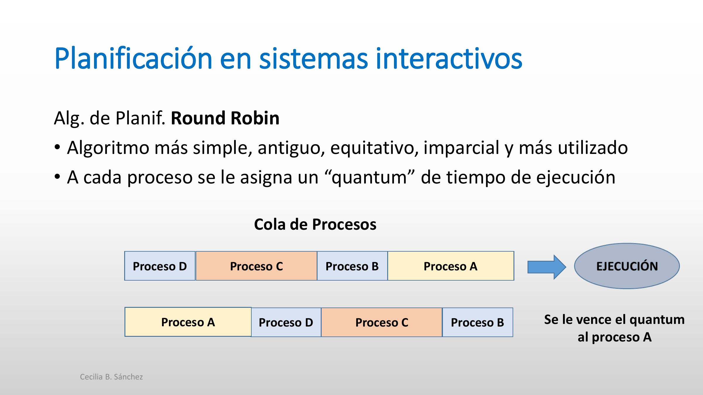

2. **Planificación por Prioridad:**
   - A cada proceso se le asigna una prioridad de forma **estática o dinámica** *(Pregunta 16 del parcial)*.
   - **Riesgo crítico:** sin mecanismos de **envejecimiento** (*aging*), los procesos de baja prioridad pueden sufrir **inanición** (*starvation*).
   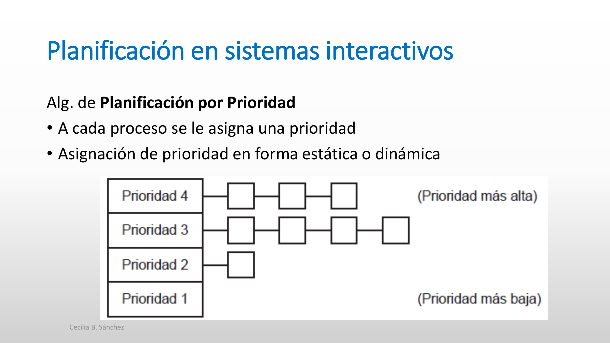

3. **Colas Múltiples:**
   - **Objetivo:** reducir el intercambio (**cambio de contexto**), ya que implica un costo administrativo para el S.O.
   - Maneja clases de prioridad donde los quantums crecen en potencias de 2: la clase más alta recibe **1 quantum**, la siguiente **2**, luego **4**, **8**, **16**, **32**, etc. Cuando un proceso agota sus quantums en una clase, **desciende a la clase inferior**.
   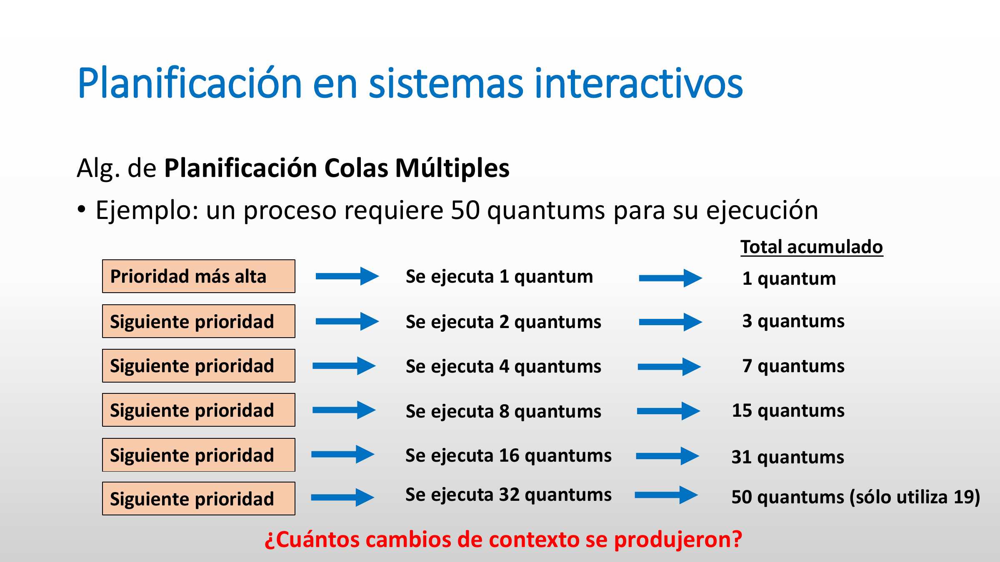

   > **Cálculo clave de parcial (Pregunta 14 real de UV):**
   > *Si un proceso requiere $Q$ quantums, ¿cuántas veces pasa del estado **Listo** a **Ejecución**?*
   > Se suman las potencias de 2 ($1 + 2 + 4 + 8 + \dots = 2^k - 1$) hasta alcanzar o superar $Q$:
   > - Ejemplo de diapositiva ($Q = 50$): $1 + 2 + 4 + 8 + 16 + 32 = 63 \ge 50$ → **6 pasadas** (en la última usa 19 de 32; se produjeron 5 descensos / cambios de contexto entre niveles).
   > - Ejemplo de parcial real ($Q = 40$): $1 + 2 + 4 + 8 + 16 = 31 < 40$; necesita una 6.ª clase ($+32 \rightarrow 63 \ge 40$) → pasa de Listo a Ejecución **6 veces** (¡no 40 veces!).

4. **Planificación Garantizada:**
   - Establece compromisos de CPU con los usuarios: si hay **$N$ usuarios** conectados, cada uno recibirá **$1/N$ de la CPU**.
   - Periódicamente calcula el cociente:
     $$\text{Ratio} = \frac{\text{CPU utilizada}}{\text{CPU prometida}}$$
   - Si el cociente es $< 1$, usó **menos** CPU de lo prometido; si es $> 1$, usó **más** de lo prometido. Se elige ejecutar primero al proceso con el **cociente más bajo** (en el ejemplo de la figura: A=0,30, B=0,50, C=1,20, D=2,00 → se ejecuta el **Proceso A**).
   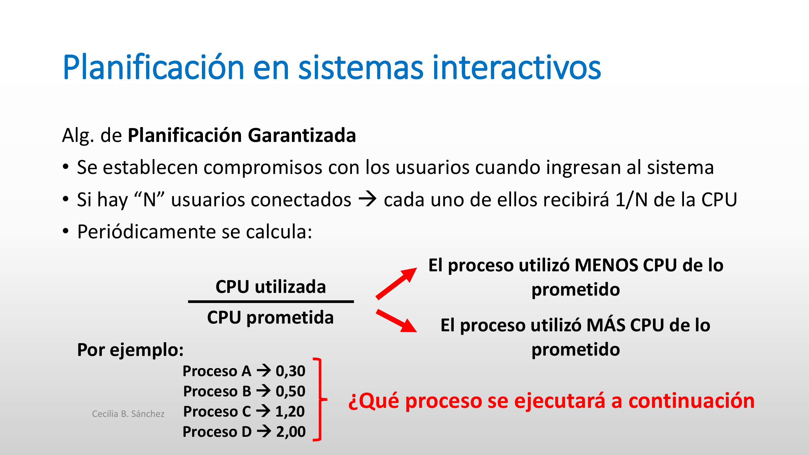

---

## Nivel 3: Vocabulario de Cátedra

- **Hilo (*Thread*) vs. Proceso:** en un entorno multihilo, el **proceso** es la unidad de asignación de recursos (espacio de direcciones y archivos), mientras que el **hilo** es la unidad de ejecución/planificación independiente dentro de ese proceso.
- **ULT vs. KLT:** hilos gestionados en espacio de usuario por biblioteca (rápidos para conmutar, bloqueo global y sin SMP) vs. hilos gestionados por el kernel (paralelismo real en SMP y bloqueo independiente, mayor costo por cambio a modo núcleo).
- **SMP vs. Micronúcleo vs. Cluster:** en **SMP** varios procesadores simétricos comparten memoria principal y cualquier CPU corre el S.O.; en un **Cluster** nodos completos con memoria distribuida se conectan por red de alta velocidad; en un **Micronúcleo** solo lo mínimo (memoria a bajo nivel, IPC con puertos, interrupciones/E-S) queda en kernel y los servicios corren como servidores en modo usuario.
- **Condición de competencia y Sección crítica:** falla dependiente del orden temporal de acceso a memoria compartida; la porción de código que accede a esa memoria es la sección crítica, protegida mediante **exclusión mutua**.
- **Planificador a corto, mediano y largo plazo:** despacho a CPU (más frecuente) vs. *swapping* a disco vs. admisión de nuevos procesos / grado de multiprogramación (menos frecuente).

---

## Nivel 4: Conclusiones y Puntos Críticos para el Parcial

1. **Hilos:** en preguntas *multiple choice*, verificar siempre si dice *"del mismo proceso"* vs. *"de todos los procesos"* (falso), y recordar que **Terminado/Finalizado NO es un estado principal** de un hilo.
2. **Condiciones de Exclusión Mutua:** en preguntas de desarrollo (12 puntos en parcial real), redactar explícitamente las **4 condiciones** con rigor: *exclusión mutua en sección crítica*, *progreso (fuera de SC no bloquea)*, *espera limitada (no espera infinita)* e *independencia de velocidad/cantidad de CPUs*.
3. **Mensajes:** son comunicación **SIN espera ocupada**; recordar la función del `C.R.C.` (integridad) y del `Nro. de Secuencia` (detectar duplicados cuando se pierde un `ACK`).
4. **Colas Múltiples:** nunca confundir cantidad de quantums requeridos ($40$) con la cantidad de transiciones Listo → Ejecución ($6$ porque $1+2+4+8+16+32 \ge 40$).
