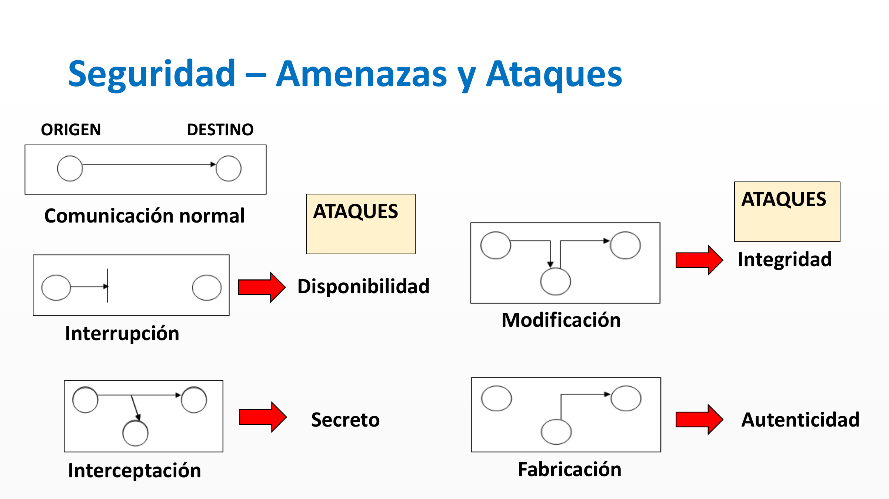
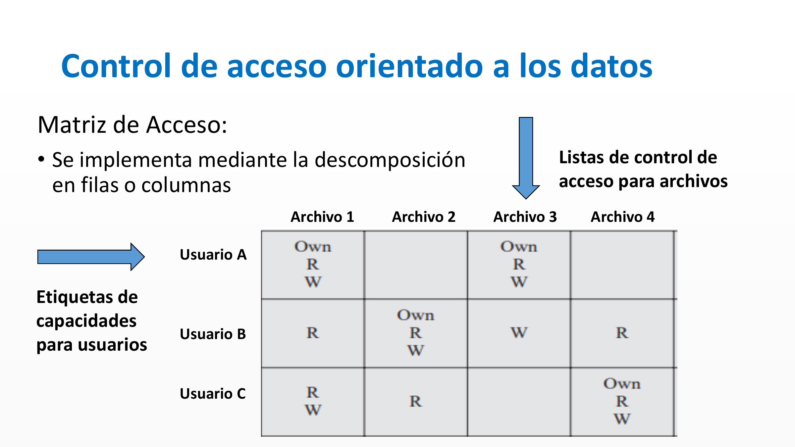
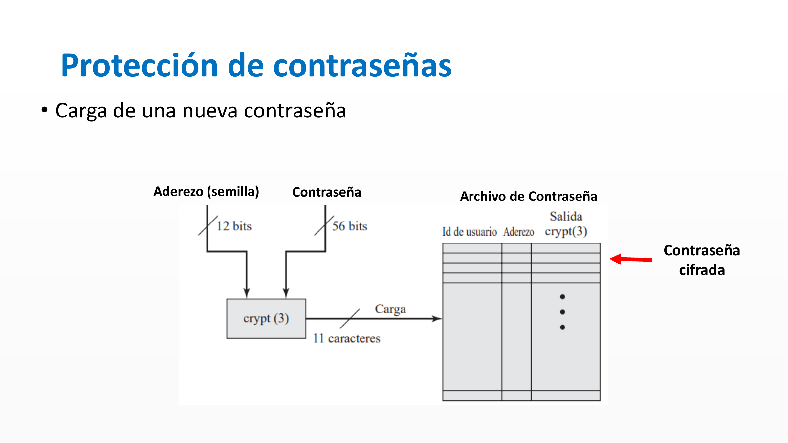
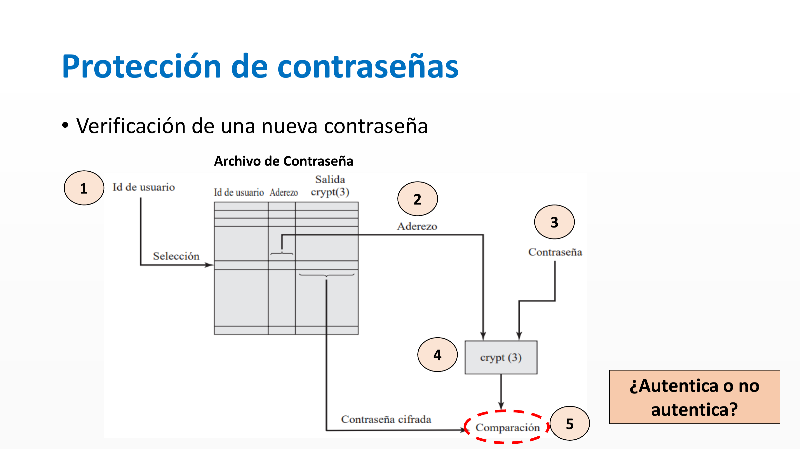
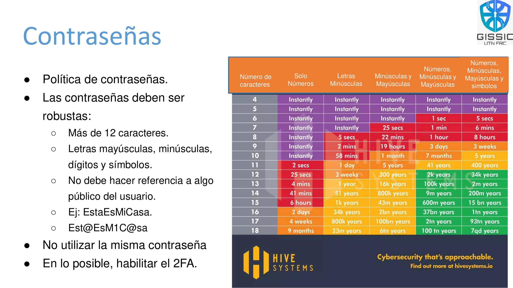
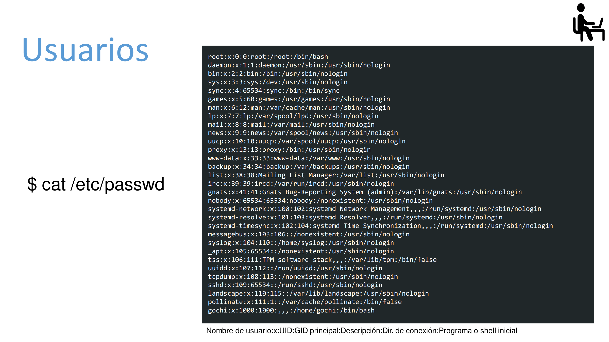
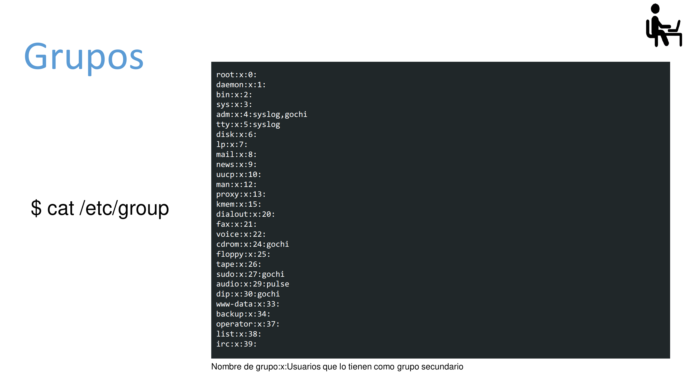
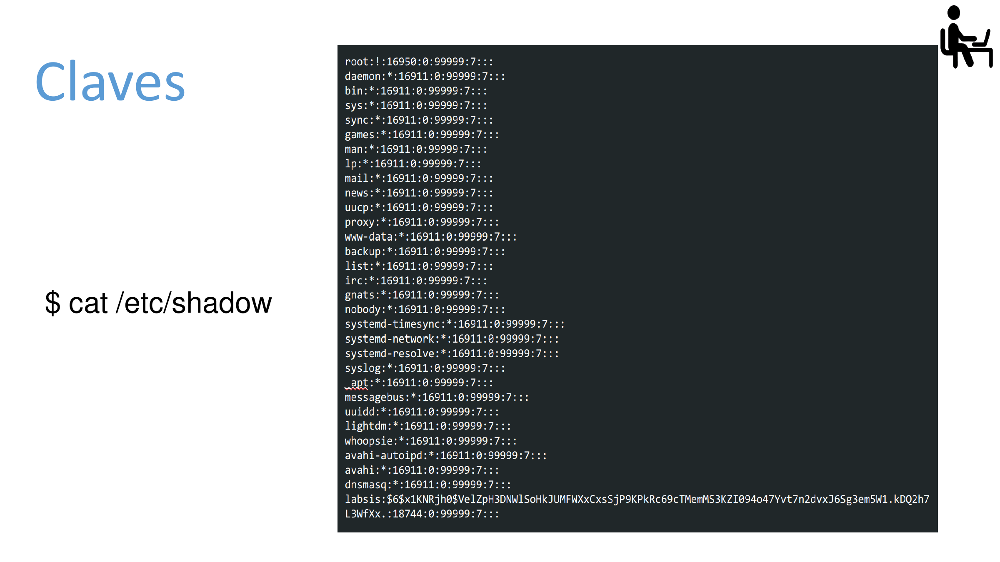
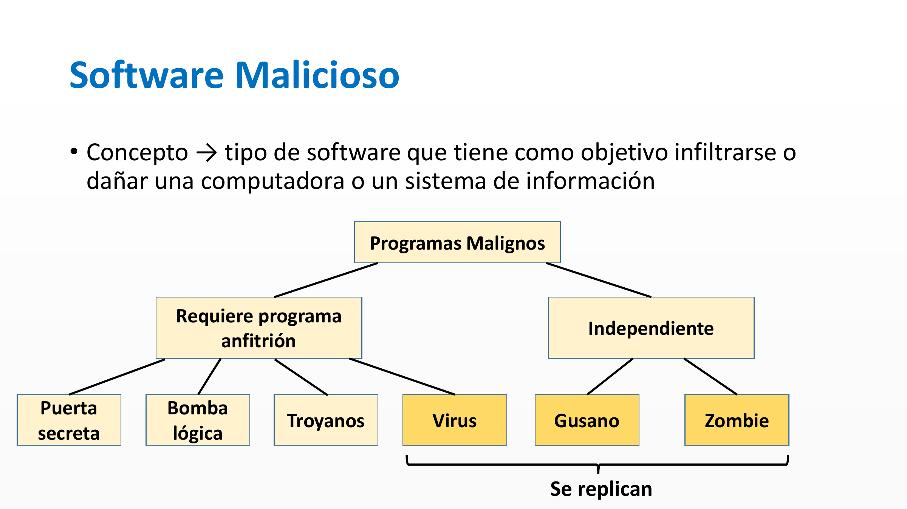

# Resumen Multinivel — Unidad 4: Seguridad en Sistemas Operativos

---

## Nivel 1: Visión General y Síntesis Ejecutiva

- **Tema central:** Mecanismos de protección interna, autenticación, control de acceso, auditoría y defensa frente a amenazas, intrusos y software malicioso en un Sistema Operativo multiusuario y conectado en red.
- **Tesis organizadora:** La seguridad informática garantiza cuatro requisitos clásicos (**Confidencialidad, Integridad, Disponibilidad y Autenticidad**) frente a amenazas pasivas y activas mediante **protección de memoria y datos** (matriz de acceso), **autenticación robusta** (funciones *hash* unidireccionales con semilla/*aderezo*, políticas proactivas y archivos protegidos en Linux), **detección de intrusos por auditoría** y **prevención/detección de malware**.
- **Ejes del resumen:**
  1. Requisitos, Amenazas, Elementos del sistema informático y Ataques Pasivos vs. Activos.
  2. Protección (niveles, memoria virtual y matriz de acceso: ACL vs. capacidades).
  3. Intrusos, Contraseñas, Aderezo (*Salt*), Estrategias de selección y Administración de cuentas en Linux.
  4. Detección de intrusos (auditoría), Software Malicioso (*malware*) y Antivirus.

---

## Nivel 2: Desarrollo Analítico Completo

### Eje 1: Requisitos de Seguridad, Amenazas y Ataques

#### 1.1 Los 4 Requisitos Clásicos de Seguridad
1. **Confidencialidad (Secreto):** la información debe ser accedida **solamente por partes autorizadas**.
2. **Integridad:** los elementos/datos pueden ser **modificados solo por partes autorizadas**.
3. **Disponibilidad:** los recursos y datos deben estar **accesibles/disponibles para las partes autorizadas** cuando los necesiten.
4. **Autenticidad:** el sistema debe **verificar la identidad** de los usuarios/emisores.

#### 1.2 Las 4 Amenazas a la Seguridad y su Impacto

| Amenaza | Qué ocurre en el flujo de comunicación | Requisito vulnerado |
|---|---|---|
| **Interrupción** | Se **destruye o inutiliza** un componente del sistema (disco duro, canal de comunicación, archivo). | **Disponibilidad** |
| **Interceptación** | Una parte no autorizada **consigue acceso** al sistema o a sus datos (espionaje). | **Confidencialidad / Secreto** |
| **Modificación** | Un elemento no autorizado **altera/modifica** un componente, dato o mensaje del sistema. | **Integridad** |
| **Fabricación o Invención** | Un elemento no autorizado **inserta registros o mensajes falsos** en el sistema. | **Autenticidad** |

#### 1.3 Elementos de un Sistema Informático y sus Amenazas
- **Hardware:** amenaza a la **disponibilidad** (daños accidentales, robo de equipos) → *Solución:* medidas de seguridad física y administrativas.
- **Software:** amenazas a la **disponibilidad**, virus/ataques informáticos, copias ilegales → *Solución:* copias de respaldo (*backup*), actualizaciones, antivirus, licencias.
- **Datos:** amenazas a la **disponibilidad**, secreto, integridad y análisis estadístico no autorizado.
- **Redes y líneas de comunicaciones:**

| Tipo de Ataque | Naturaleza | Variantes específicas | Prevención / Detalle |
|---|---|---|---|
| **Ataques Pasivos** | **Acceden** a la información en tránsito pero **NO alteran** los recursos ni el flujo (espionaje/monitorización). | 1. **Revelación del contenido de mensajes** 2. **Análisis de tráfico** (observa frecuencia, origen/destino y longitud). | Se previenen mediante **Cifrado de datos**. |
| **Ataques Activos** | **Modifican** el flujo de datos o **crean flujos falsos**. | 1. **Enmascaramiento (suplantación):** una entidad se hace pasar por otra. 2. **Reenvío (*replay*):** captura datos y los retransmite para producir un efecto no autorizado. 3. **Modificación de mensajes:** altera, borra o reordena datos. 4. **Denegación de servicios (DoS):** deja un recurso (PC, servidor o red) indisponible para usuarios legítimos. | Se detectan y mitigan mediante autenticación, integridad, auditoría y disponibilidad. |

---

### Eje 2: Protección de Memoria y Control de Acceso

La multiprogramación permite compartir procesador, dispositivos de E/S, memoria, programas y datos → surge la **necesidad de protección**.

#### 2.1 Niveles de Protección (de menor a mayor control)
1. **Ninguna protección.**
2. **Aislamiento:** cada proceso tiene su **propio** espacio de direcciones, archivos y objetos.
3. **Compartir todo o nada:** un objeto es completamente público o completamente privado.
4. **Compartir a través de limitaciones de acceso:** se verifica el acceso de cada usuario sobre cada objeto.
5. **Acceso vía capacidades dinámicas:** los derechos de acceso sobre los objetos se crean dinámicamente.
6. **Uso limitado de un objeto:** se controla no solo el acceso al objeto sino **qué uso** se hace de él (ej.: permisos `rwx` sobre cada archivo).

#### 2.2 Protección de la Memoria *(enfoque de Seguridad — U4; la Unidad 5 de Memoria no entra en este parcial)*
- Con multiprogramación y **memoria virtual** (paginación o segmentación) se separan los espacios de memoria de los distintos procesos.
- **Aislamiento total:** solo el proceso dueño accede a la página o segmento asignado (**no debe haber entradas duplicadas** en tablas de páginas y/o segmentos).
- **Si se permite compartición:** una misma página o segmento puede referenciarse en más de una tabla. Es **más simple de implementar en segmentación** porque los segmentos corresponden a unidades lógicas manejadas por la propia aplicación.

#### 2.3 Control de Acceso Orientado al Usuario vs. a los Datos
- **Orientado al usuario:** proceso de *login* (`ID de usuario + Contraseña`) en sistemas de tiempo compartido o en entornos distribuidos (**Centralizado** vs. **Descentralizado**).
- **Orientado a los datos:** una vez que el usuario ingresó, controla qué operaciones tiene permitidas mediante **perfiles de usuario** (sobre archivos o registros de un SGBD) y la **Matriz de Acceso**.

- **Componentes de la Matriz de Acceso:**
  - **Sujeto:** entidad activa (usuario o proceso) que accede a los objetos *(filas)*.
  - **Objeto:** recurso pasivo (archivos, partes de archivos, programas, segmentos de memoria) *(columnas)*.
  - **Derecho de acceso:** operación permitida sobre un objeto (`Own`, `R` leer, `W` escribir, ejecutar) *(celdas)*.
- **Descomposición práctica** (la matriz completa sería enorme y dispersa si hay muchos usuarios/objetos):
  - **Por columnas → Listas de Control de Acceso (ACL):** cada objeto/archivo almacena qué usuarios tienen qué derechos sobre él.
  - **Por filas → Etiquetas de Capacidades (*Capabilities*):** cada usuario/proceso porta una lista de los objetos a los que puede acceder y con qué permisos.

---

### Eje 3: Intrusos, Contraseñas, Aderezo (*Salt*) y Cuentas en Linux

#### 3.1 Técnicas de Intrusión y Protección del Archivo de Contraseñas
- **Técnicas comunes para descubrir contraseñas:** probar contraseñas por defecto, probar contraseñas cortas, ataques de diccionario del sistema, recopilar datos personales/familiares (teléfono, DNI, patente), o intervenir la línea entre un usuario remoto y su oficina.
- **Cómo protege el sistema el archivo de contraseñas:**
  1. **Hash criptográfico unidireccional** *(en las diapositivas históricas de Stallings figura como "cifrado unidireccional" usando `crypt(3)`, pero en parciales la profesora exige distinguir **función hash criptográfica unidireccional** de cifrado reversible — ver Pregunta 11 de `parcial p2 sop napter.pdf`!)*.
  2. **Control de acceso estricto:** solo el superusuario/procesos privilegiados leen el archivo con los hashes (`/etc/shadow`).

#### 3.2 Aderezo (*Salt* / Semilla): Carga y Verificación (Pregunta 11 real de Parcial)

- **¿Qué es el aderezo (*salt*)?** Un valor generado de forma **aleatoria** por el sistema (12 bits en el esquema clásico con `crypt(3)`) que se combina con la contraseña del usuario (56 bits) para calcular un **hash** (salida de 11 caracteres en el esquema clásico), y **se almacena en texto plano** junto al ID de usuario y al **hash generado** en el archivo de contraseñas. **Nunca se guarda la contraseña en texto plano.**
- **Las 3 funciones del aderezo:**
  1. **Permitir y ocultar contraseñas duplicadas:** si dos usuarios eligen la misma clave, sus *salts* aleatorios distintos producen **hashes diferentes**, evitando que un intruso note contraseñas repetidas.
  2. **Incrementar la longitud efectiva** de la entrada al algoritmo, haciendo la clave más fuerte.
  3. **Evitar ataques por fuerza bruta con hardware dedicado / tablas precalculadas** (implementaciones hardware de DES), obligando a recomputar por cada semilla.
- **Mecánica de Verificación (5 pasos del diagrama):**
  1. El usuario ingresa su **ID de usuario** y selecciona su registro en el archivo de contraseñas.
  2. Se lee el **aderezo almacenado en texto plano** correspondiente a ese usuario.
  3. Se toma la **contraseña ingresada** en el login.
  4. Se pasa `(aderezo + contraseña ingresada)` por la misma función hash unidireccional (`crypt(3)`).
  5. **Comparación:** se compara el hash recién recalculado contra el hash guardado en el archivo. Si coinciden, autentica; si no, rechaza.

#### 3.3 Estrategias de Selección y Política de Contraseñas Robustas

| Estrategia | Cómo funciona | Ventajas / Inconvenientes |
|---|---|---|
| **a) Educación de usuarios** | Se instruye al usuario a crear claves fuertes. | Difícil de lograr en la práctica. |
| **b) Generadas por la PC** | El sistema genera claves aleatorias. | Rechazada por usuarios; difícil de recordar; **terminan anotándolas en papel**. |
| **c) Verificación reactiva** | El sistema ejecuta periódicamente un cracker; si descubre una clave débil, la cancela y notifica. | **Inconveniente:** las contraseñas débiles quedan **vulnerables hasta que son detectadas**. |
| **d) Verificación proactiva** | El usuario elige su clave, pero el sistema la **verifica en el momento** del alta/cambio y la acepta o rechaza según reglas. | El administrador debe equilibrar exigencia de seguridad con aceptación del usuario. |

- **Política recomendada de contraseñas robustas:** más de **12 caracteres**, combinar **mayúsculas, minúsculas, dígitos y símbolos** (`Est@EsM1C@sa`), no hacer referencia a datos públicos del usuario, **no reutilizar la misma contraseña** en distintos servicios y habilitar **2FA** (doble factor de autenticación).

#### 3.4 Administración Práctica de Usuarios y Grupos en Linux (Slides 25-36)

| Archivo | Qué almacena y estructura de campos |
|---|---|
| **`/etc/passwd`** | Información pública de cuentas de usuario (**7 campos** separados por `:`): `Nombre_usuario : x : UID : GID_principal : Descripción : Dir_conexión : Shell_inicial` *(La `x` indica que el hash de la clave está en `/etc/shadow`; aquí figura el **grupo primario**)*. |
| **`/etc/group`** | Grupos del sistema y **grupos secundarios** (**4 campos**): `Nombre_grupo : x : GID : Usuarios_con_ese_grupo_como_secundario` |
| **`/etc/shadow`** | **Claves cifradas/hasheadas y políticas de expiración** (legible solo por `root`). Campos: 1. Nombre de usuario · 2. Clave cifrada (`!` o `*` = bloqueada) · 3. Última modificación (en días desde 1970) · 4. Días mínimos para cambiar clave · 5. Días máximos de validez · 6. Período de advertencia · 7. Período de inactividad tras expirar (vacío = nunca caduca) · 8. Fecha de caducidad de cuenta · 9. Reservado para uso futuro. |
| **`/etc/gshadow`** | Contraseñas cifradas de los **grupos** (configuradas con `gpasswd`). |

| `/etc/passwd` | `/etc/group` | `/etc/shadow` |
|---|---|---|
|  |  |  |

**Comandos esenciales enseñados en Unidad 4:**
- `# adduser pruebauser` → crea usuario nuevo.
- `# usermod -G prueba pruebauser` → agrega grupo(s) secundario(s) (separados por coma).
- `# usermod test3 -d /home/test2` → modifica directorio *home*; `# usermod test3 -s /bin/script.sh` → modifica shell inicial.
- `$ sudo userdel pruebauser2` + `$ sudo rm -r /home/pruebauser2` → elimina usuario y su *home*.
- **`su` vs. `sudo`:**
  - **`sudo`** ejecuta **un comando puntual** como otro usuario (`$ sudo -u otro_usuario ls -l`; sin `-u` asume `root`).
  - **`su`** (*Switch User*) inicia sesión como otro usuario: **`$ su - otro_usuario`** cambia también al *homedirectory* y entorno del usuario destino; **sin el `-`** inicia sesión **sin cambiar el directorio actual**. Se sale con `exit`.
- **`newgrp` y `gpasswd`:** incorporar un usuario a un grupo solo lo hace `root`, a menos que el grupo tenga contraseña (configurada con **`gpasswd`**); en ese caso el usuario puede usar **`newgrp`** para unirse temporalmente a ese grupo.

---

### Eje 4: Detección de Intrusos, Software Malicioso y Antivirus

#### 4.1 Detección de Intrusos (Segunda línea de defensa)
- **Objetivos:**
  1. Detectar al intruso **lo más rápido posible** para identificarlo y expulsarlo evitando daños mayores.
  2. Recolectar información sobre técnicas de intrusión para **reforzar los servicios de prevención**.
- **Principio de detección:** el comportamiento de un intruso difiere del de un usuario legítimo. A partir de datos históricos se modela el comportamiento "normal" y se definen reglas para detectar **desviaciones significativas**.
- **Registros de auditoría (5 elementos obligatorios):**
  1. **Sujeto:** quien inicia la acción (terminal de usuario o proceso).
  2. **Acción:** operación realizada por el sujeto sobre el objeto (acceso, lectura, ejecución, E/S).
  3. **Objeto:** receptor de la acción (archivos, programas, mensajes, registros, impresoras).
  4. **Utilización de recursos:** cantidad de líneas impresas, tiempo de CPU, registros accedidos.
  5. **Sello de tiempo:** fecha y hora exacta de la acción.

#### 4.2 Software Malicioso (*Malware*)

- **Concepto:** software diseñado para infiltrarse o dañar una computadora o sistema de información.
- **Clasificación según dependencia e independencia / replicación:**
  - **Requieren programa anfitrión:**
    - **Puerta secreta (*Backdoor*):** punto de entrada secreto en un programa que salta los controles estándar de seguridad (usado inicialmente por programadores para depurar; difícil de detectar por el S.O.; amenaza si se usa para accesos no autorizados).
    - **Bomba lógica:** código insertado en un programa legítimo que se activa bajo **ciertas condiciones** (una fecha, cantidad de ejecuciones, etc.) para modificar/borrar datos o detener la máquina.
    - **Troyano (*Caballo de Troya*):** programa aparentemente útil que oculta código dañino; realiza indirectamente acciones que un usuario no autorizado no podría hacer directamente (ej.: cambiar permisos al abrir un visor de archivos). Variantes: *backdoors, botnets, dialer, keylogger*.
    - **Virus *(requiere anfitrión Y se replica)*:** fragmento de código que infecta otros programas insertándose en ellos y ejecutándose en secreto cuando corre el anfitrión. Desarrollados para explotar debilidades de un S.O. específico.
  - **Independientes *(se ejecutan por sí solos Y se replican)*:**
    - **Gusanos (*Worms*):** utilizan conexiones de red (correo, ejecución o conexión remota) para expandirse de un sistema a otro sin necesitar anfitrión; una vez activos pueden actuar como virus, troyanos o destruir datos.
    - **Zombies (*Botnets*):** toman el control de cientos de PCs conectadas a Internet sin que sus dueños lo sepan para lanzar ataques difíciles de rastrear (típicamente **DDoS / Denegación de Servicios** contra sitios web).
- **Otros tipos de malware:**
  - **Rootkits:** modifican el S.O. para **ocultar** la presencia del malware al usuario.
  - **Spyware:** recopilan información sobre la actividad del usuario y la envían a terceros/agencias.
  - **Adware:** muestra publicidad intrusiva (*pop-ups*).
  - **Ransomware:** **cifra archivos** de la víctima y exige un **rescate** para entregar la clave de descifrado.
  - **Robo de información:** **Keyloggers** (registran pulsaciones del teclado) y **Stealers** (roban credenciales, usuarios, contraseñas y tarjetas).

#### 4.3 Antivirus: Pasos y Estrategias de Detección
- **3 Pasos del antivirus:**
  1. **Detección:** determinar la infección y localizar el virus.
  2. **Identificación:** identificar qué virus específico infectó el programa.
  3. **Eliminación:** borrar todo rastro del virus del programa infectado.
  *(Es fundamental mantener actualizada la base de datos de firmas).*
- **4 Estrategias de detección:**
  1. **Firmas de virus:** compara contra una base de datos de firmas de virus conocidos.
  2. **Detección heurística:** escanea buscando patrones de código similares a los usados por virus (detecta variantes nuevas).
  3. **Detección por comportamiento:** escanea el sistema tras detectar fallos, anomalías o acciones sospechosas.
  4. **Detección por caja de arena (*sandbox*):** ejecuta el software en un entorno aislado/máquina virtual **antes** de implementarlo en máquinas reales para observar si ejecuta instrucciones maliciosas.

---

## Nivel 3: Vocabulario de Cátedra

- **Hash criptográfico unidireccional vs. Encriptación:** la encriptación es **reversible** (con una clave se recupera el texto original); una función **hash unidireccional** (como `crypt(3)` / SHA) es irreversible: sirve para almacenar contraseñas y verificar por **comparación de hashes recalculados**, nunca para "desencriptar" la clave.
- **Aderezo (*Salt*/Semilla):** valor aleatorio guardado en texto plano junto al hash en el archivo de contraseñas; impide hashes idénticos para contraseñas repetidas y frena ataques por diccionario/tablas precalculadas.
- **ACL vs. Etiqueta de capacidades:** descomposición por **columnas** (por objeto/archivo) vs. descomposición por **filas** (por usuario/sujeto) de la Matriz de Acceso.
- **Ataque pasivo vs. Ataque activo:** el pasivo observa sin alterar (compromete confidencialidad; se previene cifrando); el activo altera el flujo o inventa mensajes/bloquea servicios (suplantación, reenvío, modificación, DoS).

---

## Nivel 4: Conclusiones y Trampas de Parcial

1. **Rúbrica de 10 en "Aderezo / Salt" (Pregunta 11 real de UV):** la profesora bajó de 12 pts a 4 pts a quien escribió *"encriptar la contraseña"* y *"se guarda la contraseña junto al aderezo"*. En el parcial decir siempre: **función hash criptográfica unidireccional**, semilla **aleatoria** guardada en **texto plano** junto al **hash generado** (nunca la contraseña), y verificación por **recálculo del hash** (contraseña ingresada + semilla almacenada) y **comparación** contra el hash guardado, con fin principal de **evitar hashes idénticos ante contraseñas duplicadas**.
2. **Mapeo exacto Amenaza ↔ Requisito:** *Interrupción → Disponibilidad*; *Interceptación → Secreto/Confidencialidad*; *Modificación → Integridad*; *Fabricación → Autenticidad*.
3. **Clasificación de Malware:** recordar qué requiere anfitrión (puerta secreta, bomba lógica, troyano, **virus**) vs. independiente (**gusano**, **zombie**), y cuáles **se replican** (**virus, gusano, zombie**).
